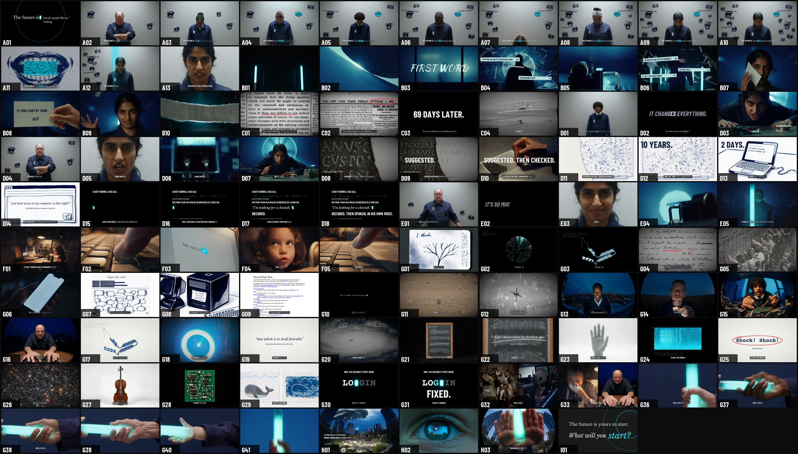
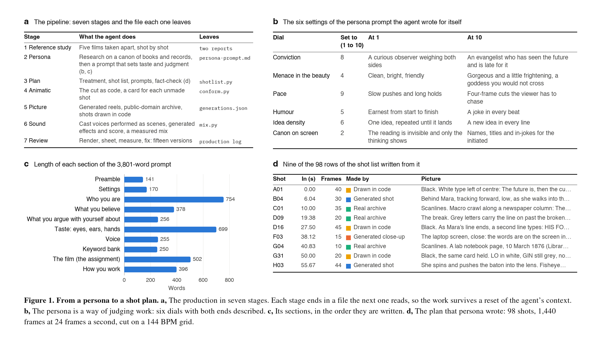
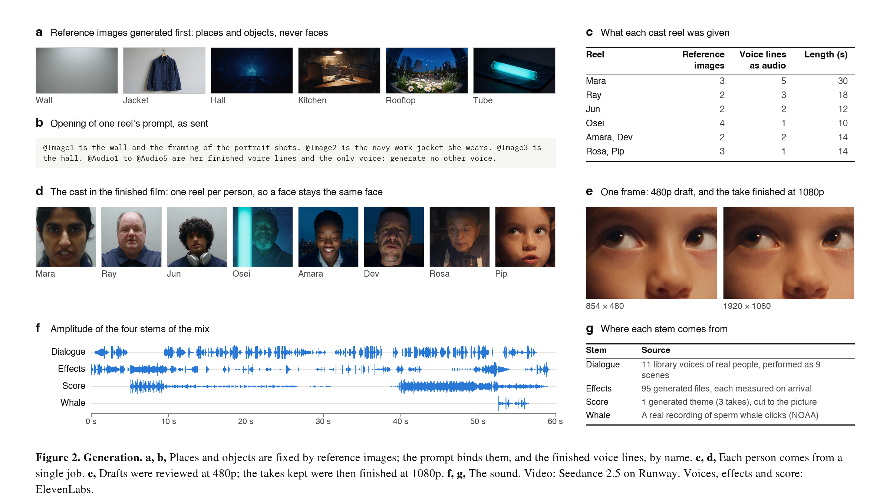
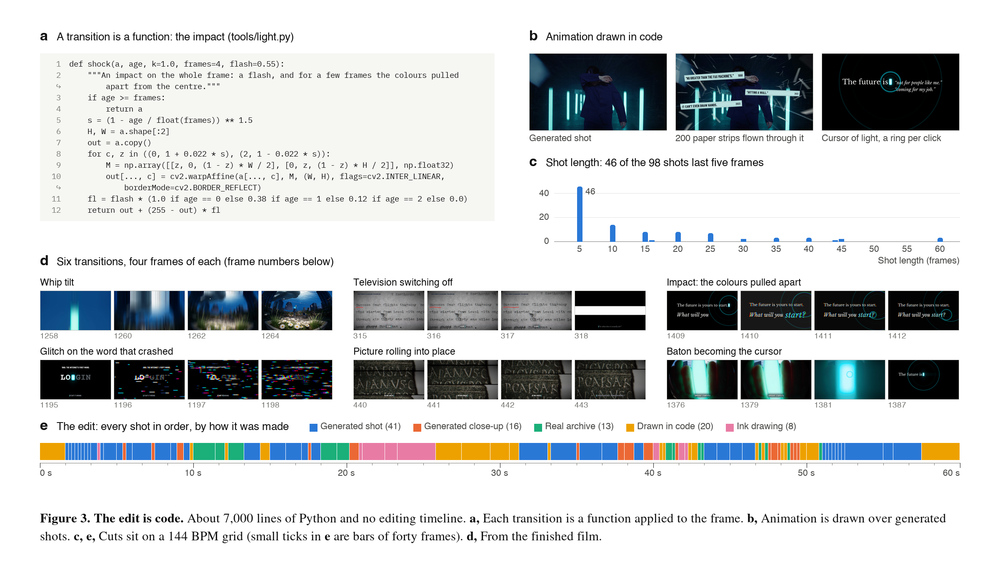
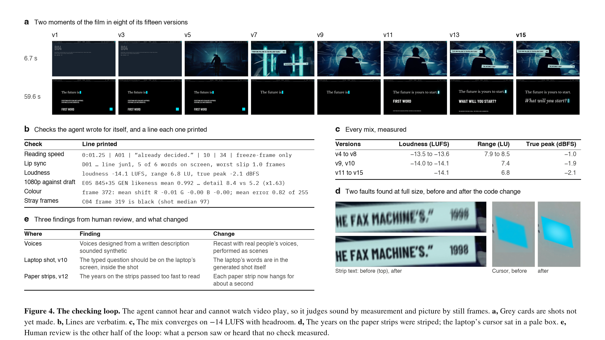

# FIRST WORD

**An agent-directed production pipeline for a one-minute film: the film, its media, code, data, prompts and the production record**

**[Project page](https://muratcankoylan.github.io/first-word/)** · [Watch the film](film/first_word_1080.mp4) · [Method](docs/method.md)



## Abstract

FIRST WORD is a 60-second film about AI and the future: 98 shots, 24 frames a second, cut to a 144 BPM grid.
Nothing in it was filmed. A single AI agent (Claude Fable 5.2, running in Claude Code) carried out every production
role over two days: reference analysis, a persona for the film's maker, the treatment and shot list, fact-checking,
video generation, archive research and rights records, voice casting and direction, sound design, the edit, colour,
and mastering. A human director set the brief, supplied references and credentials, approved the plan and the budget,
and reviewed each version by watching and listening.

This repository is the complete record of that production: the film and the media it is built from, the pipeline
(about 8,400 lines of Python), the edit as data, the persona prompt, the plan, the reference studies, the rights
records, the cost ledger, and a production log that includes what failed. The film rebuilds from it. It is
published so the method can be read, checked and borrowed from.

## Contributions

1. **The edit as a program.** The cut is code and data ([shotlist.py](shotlist.py), [timing/](timing/)). A conform
   builds the film from it and draws a placeholder card for any shot that does not exist yet, so a complete,
   watchable film exists from the first hour and every change is a full re-render.
2. **Verification without perception.** The agent cannot hear and cannot watch video play. Picture is judged on
   contact sheets of rendered frames; sound by measurement (loudness, true peak, energy by frequency band, where a
   hit's sharpest moment falls against its frame); lip sync by transcribing the audio; legibility by a
   reading-load report on every line of on-screen text. What these checks caught, and what only a person caught,
   is tabulated in [docs/method.md](docs/method.md#failure-analysis).
3. **A tunable persona.** A 3,800-word system prompt that sets taste and judgment, not a character to act, with six
   numbered dials and each belief paired with what it does to the film ([persona/](persona/)).
4. **Character consistency without face references.** The video model refuses a face as a reference. Each person is
   generated in one job from a fixed written description, and that person's shots are cut from that one take.
5. **Provenance by construction.** Every real picture is public domain, has a rights record quoting its holder,
   and carries one visual treatment that nothing generated carries. Eighteen factual claims were checked against
   sources that were opened and read.
6. **State that survives context resets.** The agent's context was replaced by a summary six times. The plan, the
   production log, the ledger and a short list of learned rules carried the work across
   ([docs/method.md](docs/method.md#state-across-context-resets), [docs/learned-rules.md](docs/learned-rules.md)).
7. **An audit against plan drift.** The agent's own notes drifted toward what had been built. Auditing the approved
   plan against rendered frames and the measured mix found four reworded rows and about ten missing sounds.
8. **A film that rebuilds from its repository.** From a clean copy of this repository, the score, the mix, the
   four stems and the 1080p master were rebuilt, and each matched the original byte for byte
   ([Reproducing](#reproducing)).

## The result

| | |
| --- | --- |
| Length | 60 seconds, 1,440 frames, 98 shots |
| Cut lengths | Median 10 frames (0.42 s). 46 shots last five frames (0.21 s). The longest lasts 60 frames (2.5 s) |
| Picture, by shots | 41 generated video, 16 generated close-ups, 13 public-domain archive, 20 drawn in code, 8 ink over picture |
| Picture, by running time | 46% generated video, 9% generated close-ups, 11% archive, 23% code, 10% ink |
| Voices | 38 spoken lines; 8 generated characters |
| Video model | Seedance 2.5 on Runway: 480p drafts, then the chosen takes finished at 1080p |
| Sound | ElevenLabs: licensed voices from its Voice Library, each scene performed as one conversation; generated effects; one generated theme cut to the picture |
| Mix | -14.1 LUFS integrated, 6.8 LU range, true peak -2.1 dBFS |
| Masters | 1080p H.264 and ProRes 422 HQ (BT.709), HLG HDR (peak 784 nits, only the film's own lights above white), and a vertical version |
| Iterations | 15 versions, each rendered, sheeted, measured and corrected |
| Cost | 199.85 USD of video and image generation against a 600 USD cap (75 ledger entries, 3 of them failed calls); voices and sound on an existing plan |
| Time | Two days, about 1,900 tool calls |

## Pipeline



Seven stages, each ending in a file the next one reads:

1. **Reference study.** Five films taken apart shot by shot: cut lengths, how each picture was made, tempo, sound
   ([docs/reports/](docs/reports/)).
2. **Persona.** Research on a canon of books and records, then the prompt ([persona/](persona/)).
3. **Plan.** Treatment, shot list, prompts and a fact-check, in one living document ([docs/plan/](docs/plan/)).
4. **Animatic.** The cut as code, with a card for every shot not yet made.
5. **Picture.** Generated reels, public-domain archive, and shots drawn in code.
6. **Sound.** Cast voices performed as scenes, generated effects and score, a measured mix.
7. **Review.** Render, contact sheet, measure, fix. Fifteen times.





## Verification



Most of the two days went into the review loop. [docs/method.md](docs/method.md) describes it and lists sixteen
failures with how each was caught. Human review caught the perceptual ones: voices that sounded synthetic,
graphics that looked like placeholders, text that passed too fast. The agent's own checks caught the measurable
ones: effects landing two thirds of a frame late, a wrong colour matrix, plan drift.

## Repository map

| Path | What it is |
| --- | --- |
| [docs/method.md](docs/method.md) | The method: stages, verification loops, state across context resets, guard rails, failure analysis, the human role |
| [docs/learned-rules.md](docs/learned-rules.md) | The operating rules the agent accumulated from review |
| [docs/production-log.md](docs/production-log.md) | The agent's running record, pass by pass: what was done, decided, and left open |
| [docs/pipeline.md](docs/pipeline.md) | Every tool and data file, and the rebuild order |
| [docs/plan/](docs/plan/) | The living plan: treatment, shot list, prompts |
| [docs/reports/](docs/reports/) | The two reference studies |
| [docs/figures/](docs/figures/) | The four figures and the contact sheet of the finished film |
| [film/](film/) | The film: the 1080p master, the HDR master, the vertical version and its HDR copy |
| [clips/](clips/) | The picture the film is built from: the sixteen generated takes at 1080p, the stills, and the shots made by the tools |
| [audio/](audio/) | The sound: the mix, its four stems, every spoken line, every effect, the score and what it is cut from |
| [docs/index.html](docs/index.html), [tools/site.py](tools/site.py) | The project page and the tool that writes its data from this repository |
| [persona/](persona/) | The persona prompt, its tuning notes, and how it was made |
| [shotlist.py](shotlist.py), [timing/](timing/) | The edit as data: shots, lines, type, sound, prompts, lip sync |
| [tools/](tools/) | The pipeline: conform, generation, archive, code-drawn shots, voices, sound, mix, HDR, the vertical version, figures |
| [archive/](archive/) | The index of real sources and a rights record for each |
| [skills/](skills/README.md) | The skills, tools and services the agent used, linked |
| [ledger.csv](ledger.csv), [budget.json](budget.json) | Every paid call, and the cap the tools enforce |

## Reproducing

The tools need Python 3 with Pillow, numpy, scipy and OpenCV, and ffmpeg. They were written and run on macOS.

```bash
# the animatic: the whole cut, with a card for every shot
python3 shotlist.py
mkdir -p out
python3 tools/conform.py --out out/animatic.mp4

# the sound: the score, then the mix and its four stems
python3 tools/score_build.py
python3 tools/mix.py --out audio/mix_v015.wav

# the film at 1080p, from the takes in clips/
python3 tools/conform.py --out out/first_word_1080.mp4 --size 1920x1080 --audio audio/mix_v015.wav --clean --crf 14 --preset slow
```

What was checked, each time from a clean copy of this repository:

- **The sound.** `audio/music/score_cut2.wav`, `audio/mix_v015.wav` and the four stems came out identical to the
  files here, byte for byte.
- **The picture.** The 1080p film came out identical to `film/first_word_1080.mp4`, byte for byte (about ten
  minutes on a laptop). That was on the machine the film was made on, with the same ffmpeg and x264. On another
  build the frames should match and the file may not.
- **The animatic.** If `clips/` is removed, the first block still builds the whole cut with a card for each shot.

The cards and the strip of shot names on the animatic are set in a macOS system font; on another system, point
`F_UI` at the top of `tools/conform.py` to a font you have. `tools/process_figures.py` also uses macOS fonts.
Nothing was tested off macOS.

A new generation needs your own keys (copy [.env.example](.env.example) to `.env`) and will not return the same
take. [docs/pipeline.md](docs/pipeline.md) lists every tool and the full rebuild order.

**What is not in the repository:** the ProRes master (1.1 GB); the fourteen earlier versions and the drafts that
were not used; the archive's source files, which are listed in [archive/manifest.json](archive/manifest.json) with
holder, address and checksum (the processed archive shots are in `clips/`); API keys; and third-party skills and
documentation, which are linked.

## Limitations

- **One production.** This is a case study, not a benchmark. There is no control condition and no second film.
- **Not reproducible past the takes.** The film rebuilds exactly from the takes kept here. The video, voice and
  music models do not return the same take twice, so a fresh generation from the prompts in
  [timing/generations.json](timing/generations.json) would give different faces and voices.
- **Perception was human.** Every claim about how the film sounds rests on measurement and on a person listening.
  The HDR master was checked by its levels only; the agent cannot see an HDR screen.
- **Faults remain inside generated takes.** Correcting one shot of a person means regenerating that person's whole
  take, which changes the face, so such faults were listed and left. The production log names them.
- **The code is specific to this film.** It was written for these 98 shots and is not a framework.
- **Rights records are the production's own reading** of each holder's terms on the day they were captured, not
  legal advice.

## Rules the production kept

- Nothing filmed and nothing licensed: picture is generated, drawn in code, or public-domain archive.
- Everything real takes one visual treatment (scanlines) and nothing else does. Real events are never re-staged
  with generated people. Real people say only what they are on record as saying, with a source.
- No paid call may take the ledger past the cap. Every paid call is logged when it is submitted.
- No face goes into the video model as a reference. The provider refuses it and the refusal is not worked around.
- The agent states what it could not check.

## Citation

```bibtex
@misc{firstword2026,
  title  = {FIRST WORD: An Agent-Directed Production Pipeline for a One-Minute Film},
  author = {{The First Word authors}},
  year   = {2026},
  url    = {https://github.com/muratcankoylan/first-word}
}
```

## Licence

- Code (`tools/`, `shotlist.py`, the project page's code): MIT, see [LICENSE](LICENSE).
- Documents, persona, plan, reports, timing data and figures: CC BY 4.0, see [LICENSE-CONTENT.md](LICENSE-CONTENT.md).
- The film and its media (`film/`, `clips/`, `audio/`, `docs/media/`) are here to be watched, studied and rebuilt.
  They are not under either licence; see [LICENSE-CONTENT.md](LICENSE-CONTENT.md).
- Fonts, archive records and other people's work: see [NOTICE.md](NOTICE.md).
