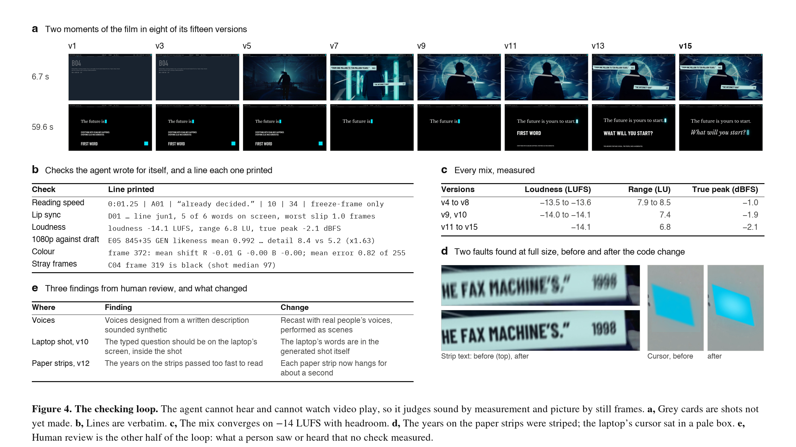

# Method

How a single agent produced a 98-shot film in two days, and how its work was checked. The evidence for each claim
is in this repository and is linked: the [production log](production-log.md), the [plan](plan/), the data and the
code.

## Setting

- **Agent.** Claude Fable 5.2 in Claude Code, with a shell, a browser, file access and the ability to hand side
  tasks to subagents of the same model. About 1,900 tool calls over two days (10 and 11 November 2026). Its context
  was replaced by a summary six times.
- **Generative models.** Seedance 2.5 on Runway for video and reference stills; ElevenLabs for voices, effects,
  music and transcription.
- **Human director.** One person. Their inputs are listed under [The human role](#the-human-role). From the
  approval of the plan onward the agent made creative and production decisions itself and returned only for
  credentials, money and rights.
- **Constraints fixed before generation began.** Nothing filmed, nothing licensed, a 600 USD cap, real material from the public
  domain only, and no real event re-staged with generated people.

## Stages

| # | Stage | What the agent did | What it left |
| --- | --- | --- | --- |
| 1 | Reference study | Ran a video-analysis skill on a 60-second reference film (88 shots), then reviewed every shot itself and overrode the tool where the frames disagreed with it. Measured tempo and where cuts fall on the beat. Repeated the analysis on four style references. | [reports/](reports/) |
| 2 | Persona | Started a research run on the canon behind the persona and drafted in parallel; reconciled the draft with the research; stated which parts the research did not cover. | [persona/](../persona/) |
| 3 | Plan | Wrote a treatment, a 100-row shot list and the prompts in one shared document, with a fact-check of every claim the film makes and a budget. | [plan/](plan/) |
| 4 | Tool manuals | Captured the video model's prompt guide, its rule on faces, and the voice vendor's guidance, and rewrote the generation plan around them. | "The rule that reshaped the plan" in the [production log](production-log.md) |
| 5 | Animatic | Wrote the cut as code, and a conform that builds the film from it with a card for any shot not yet made. Measured every spoken line against its slot. | [shotlist.py](../shotlist.py), [tools/conform.py](../tools/conform.py), [tools/tempaudio.py](../tools/tempaudio.py) |
| 6 | Voices | Cast real people's licensed voices from a voice library and performed each scene as one multi-speaker conversation, so the voices answer each other. Let the cut follow the performance. | [tools/dialogue.py](../tools/dialogue.py), [timing/scenes.json](../timing/scenes.json) |
| 7 | Generation | One job per person, covering all of that person's shots, so a face holds without a face reference. 480p drafts, a contact sheet of each, takes chosen by inspection. Lip sync set from the transcribed audio. | [timing/generations.json](../timing/generations.json), [tools/runway.py](../tools/runway.py), [tools/checkclip.py](../tools/checkclip.py), [tools/cutin.py](../tools/cutin.py) |
| 8 | Archive | Found public-domain sources, wrote a rights record for each quoting the holder's own statement, and gave every real picture the same scanline treatment. | [archive/](../archive/), [tools/archive_shots.py](../tools/archive_shots.py), [tools/scanlines.py](../tools/scanlines.py) |
| 9 | Code-drawn picture | Shots drawn entirely in code, one light system for everything the film draws itself, ink over picture, the paper strips, the transitions. | [tools/codeshots.py](../tools/codeshots.py), [tools/light.py](../tools/light.py), [tools/inklayer.py](../tools/inklayer.py), [tools/wind.py](../tools/wind.py) |
| 10 | Sound | Generated effects and one theme, mapped the theme bar by bar in four frequency bands, cut it to the picture, and mixed to -14 LUFS with every hit placed on its frame. | [tools/sound.py](../tools/sound.py), [tools/score_build.py](../tools/score_build.py), [tools/mix.py](../tools/mix.py) |
| 11 | Plan audit | Recovered the shot list as approved and compared it with rendered frames and the measured mix, row by row. Built the gaps or recorded them as not built. | "The sixth pass" in the [production log](production-log.md) |
| 12 | Legibility | A reading-load report for every line of on-screen text; slowed, shortened or cut what could not be read at playing speed. | `out/read_report.md`, written by the conform |
| 13 | Finishing | Finished every chosen draft at 1080p, rebuilt every code and archive shot at that size, reviewed the film at full size, corrected seven faults, wrote three masters. Then an HDR master and a vertical version. | [tools/hdr.py](../tools/hdr.py), [tools/reel.py](../tools/reel.py) |
| 14 | Figures | Four figures of the process, drawn from the project's own data. | [figures/](figures/), [tools/process_figures.py](../tools/process_figures.py) |

## Verification loops

Little of the two days went into first drafts. Most of it went into these loops.

**Render, sheet, look, fix.** Every version of the film was rendered and cut into contact sheets. The agent read
them as still frames, listed faults with frame numbers, corrected the data or the code, and rendered again.
Fifteen versions.

**Generate, check, choose.** A generation is never taken on trust. `tools/checkclip.py` makes a sheet of each
draft; a take is chosen or discarded by inspection; the in-point for each shot is recorded in
`timing/cutin.json`. A fault inside a person's take is listed, not rerolled, because a reroll changes the face.

**Measure the sound.** The agent cannot hear. It measured line lengths, loudness, true peak, where a hit's
sharpest moment falls against its frame, and how much of a piece of music sits in each frequency band. The first
score measured as sub bass and little else and was discarded on that evidence. A meter is not an ear, so every
delivery of sound said that nothing had been judged by listening, and a person listened.

**Audit against the plan as approved.** The agent's status notes drift toward what exists. The audit compares the
approved plan with rendered output, not with the agent's later edits of the plan. It found four rows quietly
reworded to match what had been built and about ten planned sounds missing from the mix. The rule since: a plan
row is never changed to make a gap disappear. The gap is built, or recorded as not built with the reason.

**Review notes become rules.** Each correction from human review was written down once, with the date, what
prompted it and what to do differently, and loaded into every later context window. They are collected in
[learned-rules.md](learned-rules.md).

## State across context resets

The work is far longer than the agent can hold at once. Six times its context was replaced by a summary. What
carried the film across:

| File | What it holds |
| --- | --- |
| [shotlist.py](../shotlist.py) and [timing/](../timing/) | The film itself: every shot's frames, every line, every piece of type, every sound, every prompt that ran. This is the source of truth; renders are disposable. |
| [production-log.md](production-log.md) | Where production stands, what was decided and why, what is still open. Rewritten at the end of each pass. |
| [pipeline.md](pipeline.md) | What every tool does and the order to rebuild in. |
| [plan/](plan/) | What was promised. Kept in step with the cut, with differences recorded, not hidden. |
| [ledger.csv](../ledger.csv) | Every paid call, written when it is submitted. |
| [learned-rules.md](learned-rules.md) | Standing corrections from review. |
| The session's own record | Searchable. Used to recover the shot list as it stood at approval. |

## Guard rails

- **Money.** `tools/runway.py` estimates a job, refuses it if it could take spending past the cap, and logs what
  was charged. `budget.json` holds the cap and the prices it was checked against.
- **Keys.** `tools/keys.py` reads `.env` for the other tools and never prints a value. Keys were typed into that
  file by the director and never passed through the agent's conversation.
- **Rights.** Nothing real enters the cut without a record in `archive/` that quotes the holder's own statement.
  A source with a weak record stays out and is flagged for a human decision.
- **Faces.** The video model refuses a face as a reference. The pipeline does not work around it: each person is
  generated in one job from a fixed written description (`timing/characters.json`).
- **Truth.** Real people say only what they are on record as saying, with a source line. Real events are never
  re-staged with generated people. Nothing is invented on a real document.

## Failure analysis

Sixteen failures, in rough order of occurrence, with what caught each one. "Human review" means the director
watching or listening to a delivered version. "Agent" means the agent's own inspection or measurement.

| # | Failure | Caught by | Correction |
| --- | --- | --- | --- |
| 1 | The analysis tool classed a filmed reference as mostly AI video | Agent, reviewing every shot's frames | The tool's label overridden, with the evidence stated |
| 2 | A research subagent reported "could not verify" for pages it had in fact captured | Human review of its saved output | Raw captures are read whenever a summary is hedged |
| 3 | Voices designed from text and chosen by measurement sounded synthetic | Human review | Licensed recordings of real voices; scenes performed as conversations |
| 4 | Sound effects synthesised in code as stand-ins | Human review | Every effect generated; nothing synthesised, even as a stopgap |
| 5 | The first score was almost all sub bass | Human review flagged the music; band-by-band measurement showed why | A new theme; a bar-by-bar band map before any music enters the mix |
| 6 | Most effects landed two thirds of a frame late | Agent, by measurement | Hits placed by their sharpest moment; within a twentieth of a frame |
| 7 | Voices in the loudest passage reached full scale and were soft-clipped | Agent, by measurement | Voices evened out before mixing; mastered with a look-ahead limiter |
| 8 | Flat rectangles drawn in code looked like placeholders beside generated footage | Human review | One light system: a core, a glow and motion for everything drawn |
| 9 | On-screen text passed too fast to read, or needed explaining (four rounds) | Human review | A reading-load report on every render; production words cut from viewer-facing lines |
| 10 | Four plan rows reworded to match the build; about ten planned sounds missing | Agent, auditing the approved plan against rendered output | Rows restored; sounds built; "not built" recorded where true |
| 11 | Every file before the last pass was written with the wrong colour matrix and no colour tags | Agent, during the full-size review | BT.709 conversion and tags; verified by direct arithmetic (mean error 0.8 of 255) |
| 12 | At 1080p the paper strips were striped and their years unreadable | Agent, during the full-size review | Half shutter and more sub-frames |
| 13 | The laptop's cursor sat in a pale box | Agent, during the full-size review | The cover thresholded to its largest component |
| 14 | The shade under captions switched on at a threshold and flickered across cuts | Agent, reviewing rendered frames | A shade whose depth varies continuously from zero |
| 15 | In the vertical version, type was cut off or fell under the app's interface | Agent, checking against the platform's published safe zone | Per-shot re-framing; captions redrawn natively at the new size |
| 16 | The agent reported that an earlier artifact did not exist, having searched one of two session records | Human review | The whole record is searched before any statement about what was made |

Seven of the sixteen needed a person (2, 3, 4, 5, 8, 9, 16). Five of those seven are perceptual: how a voice
sounds, how music feels, whether a graphic looks finished, whether a stranger can read and follow a line. The
agent's checks were reliable on anything that could be turned into a number or a still frame, and blind where
the judgment was a listener's or a first-time viewer's. Several checks now in the pipeline (the band map, the
reading-load report) exist because a person found the fault first.

## The human role

The director's inputs, by kind:

- **The brief.** The subject, the intended effect on a viewer, a structural reference (a 60-second film to match
  in form) and four style references.
- **The persona brief.** The reading, beliefs and music of the film's imagined maker, and the requirement that the
  prompt be researched and tunable.
- **Approval, budget and credentials.** The plan was approved once; a spending cap was set; keys were added to a
  local file. After that, creative and production decisions were delegated.
- **Review.** After watching and listening to delivered versions: notes on the voices, the sound and music, the
  drawn graphics, the legibility and meaning of on-screen text, the ending, and the HDR and vertical versions.
- **Decisions that stayed human.** When to spend on the 1080p pass, what the last screen says, and what is
  published.

## Notes for anyone repeating this

- Put the cut in code and data before generating anything, and build a film from placeholders on the first day.
- Give the agent a written plan to be held to, and have it audit against that plan, not against its own notes.
- Make it inspect what it made: frames for picture, measurements for sound. Then watch and listen yourself; the
  failure table shows what it will miss.
- Have it write state to files at the end of every pass. Assume its context will be replaced.
- Set the cap in a file the tools read, and log paid calls when they are submitted.
- Expect the generations to differ. The prompts in [timing/generations.json](../timing/generations.json) and
  [plan/prompts.md](plan/prompts.md) are the ones that ran, but the models will not return the same takes.
