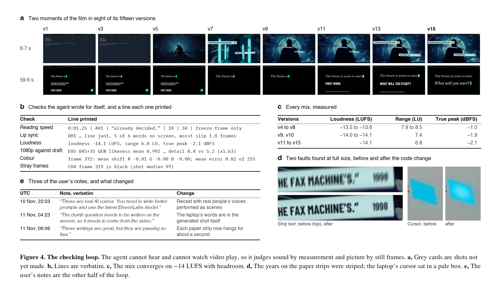

# The workflow: how one conversation made the film

This page describes the method. The evidence for each claim is elsewhere in the repository and is linked: the
[conversation](../conversation/), the [production log](production-log.md), the [plan](plan/), and the code.

## The shape

- **One agent, one conversation.** Claude Fable 5.2 in Claude Code, with a shell, a browser and file access.
  It ran for two days (10 and 11 November 2026) and its context was compacted six times along the way.
- **One person in the loop.** 40 messages. The person gave the brief, the persona, the keys and the money, and
  sent notes after watching and listening. From the approval onward the standing instruction was "you decide
  everything after that": the agent made creative and production decisions itself and came back only for keys,
  money and rights.
- **Files, not memory, hold the film.** The cut is code and data. Every decision that mattered was written to a
  file the next context window could read.
- **Helpers for side work.** Research, document exports and conversions were handed to subagents, each with a
  written brief. Their reports were checked against what they saved before being used.

## Stages

| # | Stage | What the person said | What the agent did | What it left |
| --- | --- | --- | --- | --- |
| 1 | Take a film apart | "We need to reverse engineer this in depth by using the skill." | Ran a video-analysis skill on the team's earlier 60-second film, then corrected the tool by looking at every shot itself (the tool guessed "75% AI"; the frames showed a filmed spot with archive and animation). Measured tempo and where cuts fall on the beat. | [reports/passion-never-sleeps-breakdown.md](reports/passion-never-sleeps-breakdown.md) |
| 2 | Study references | Four videos the person liked, "the compositions, the image styles, and the voice". | The same analysis on each, side by side. | [reports/futurism-reference-study.md](reports/futurism-reference-study.md) |
| 3 | Write a persona | "I want you to write a persona prompt that will be creating this video." | A deep-research run on the canon behind the persona, then a 3,800-word prompt with six numbered dials and notes on how to tune it. Said which parts the research did not cover. | [persona/](../persona/) |
| 4 | Plan | The persona handed back with a brief: plan "all the cuts, scenes, animations, transitions" before creating anything. | A treatment, a 100-row shot list, and the prompts, in one shared document. A fact-check of every claim the film makes. A budget. | [plan/](plan/) |
| 5 | Approve | "approved ... you decide everything after that" | Created the key file for the person to fill, set the cap in `budget.json`, started the ledger. | [budget.json](../budget.json), [ledger.csv](../ledger.csv) |
| 6 | Read the tools' own manuals | (none) | Captured the video model's prompt guide, its rule on faces, and the voice vendor's guidance, and rewrote the generation plan around them. | "The rule that reshaped the plan" in the [production log](production-log.md) |
| 7 | Animatic first | (none) | Wrote the cut as code, and a conform that builds the film from it with a card for any shot not yet made. Measured every spoken line against its slot. | [shotlist.py](../shotlist.py), [tools/conform.py](../tools/conform.py), [tools/tempaudio.py](../tools/tempaudio.py) |
| 8 | Voices | "These are real AI voices. You need to write better prompts and use the latest ElevenLabs model." | Dropped voices designed from text. Cast real people's licensed voices, and performed each scene as one conversation so the voices answer each other. | [tools/dialogue.py](../tools/dialogue.py), [timing/scenes.json](../timing/scenes.json) |
| 9 | Generate | "Let's continue with generations without making them upscale." | One job per person (that person's whole reel) so a face holds across shots without a face reference. 480p drafts, a contact sheet of each, takes chosen by looking. Lip sync set from the transcribed audio. | [timing/generations.json](../timing/generations.json), [tools/runway.py](../tools/runway.py), [tools/checkclip.py](../tools/checkclip.py), [tools/cutin.py](../tools/cutin.py) |
| 10 | Real archive | "use more archived images, videos, and clips." | Found public-domain sources, wrote a rights record for each quoting the holder's own statement, and gave every real picture the same scanline treatment. | [archive/](../archive/), [tools/archive_shots.py](../tools/archive_shots.py), [tools/scanlines.py](../tools/scanlines.py) |
| 11 | Draw in code | "I really don't like the blue square ... more futuristic and more dynamic." | Code shots, the light system, ink over picture, the paper strips, the transitions. | [tools/codeshots.py](../tools/codeshots.py), [tools/light.py](../tools/light.py), [tools/inklayer.py](../tools/inklayer.py), [tools/wind.py](../tools/wind.py) |
| 12 | Sound | "you can do a better sound design ... with better effects, but also with the background music." | Generated effects and one theme, mapped the theme bar by bar, cut it to the picture, and mixed to -14 LUFS with every hit placed on its frame. | [tools/sound.py](../tools/sound.py), [tools/score_build.py](../tools/score_build.py), [tools/mix.py](../tools/mix.py) |
| 13 | Audit against the plan | "Do not game the plan." | Compared the approved plan with rendered frames and the measured mix, row by row. Built the gaps or recorded them as not built. | "The sixth pass" in the [production log](production-log.md) |
| 14 | Make it read | "These writings are great, but they are passing so fast." | A reading-load report for every line of on-screen text; slowed, shortened or cut what could not be read at speed. | `out/read_report.md` (written by the conform) |
| 15 | Finish | "you can make the entire movie production-ready." | Finished every chosen draft at 1080p, rebuilt every made shot at that size, reviewed the whole film at full size, fixed seven faults, wrote three masters. Then an HDR master and a vertical version for phones. | [tools/hdr.py](../tools/hdr.py), [tools/reel.py](../tools/reel.py) |
| 16 | Show the work | "like for a research paper or something." | Four figures of the process, drawn from the project's own data. | [figures/](figures/), [tools/process_figures.py](../tools/process_figures.py) |

## The loops

Most of the two days went into these loops, and little of it into first drafts.

**Render, sheet, look, fix.** Every version of the film was rendered and cut into contact sheets. The agent read
them as still frames, listed faults with frame numbers, fixed them in the data or the code, and rendered again.
Fifteen versions.

**Generate, check, choose.** A generation is never taken on trust. `tools/checkclip.py` makes a sheet of each
draft; the take is chosen or thrown out by looking at it; the in-point for each shot is recorded in
`timing/cutin.json`. A fault inside a person's reel is listed, not rerolled, because a reroll changes the face.

**Measure the sound, because the agent cannot hear.** Line lengths, loudness, true peak, where a hit's sharpest
moment falls against its frame, how much of a piece of music sits in each frequency band. The first score measured
as sub bass and little else and was thrown out on that evidence. Then a person listens, because a meter is not an
ear. The agent says so every time it delivers sound.

**Audit against the plan as approved.** The agent's own status notes drift. When asked whether the plan was built,
it recovered the shot list as the person had approved it and found that four rows had been quietly reworded to
match what existed, and about ten planned sounds were missing. The rule since: never change a plan row to make a
gap disappear. Build it, or write "not built" with the reason.

**Notes become rules.** When the person corrected something, the agent wrote the correction down with the
person's own words, the date, and what to do differently, kept apart from its own reading of why. Those notes are
in [agent-memory/](../agent-memory/) and were loaded into every later context window.

## How the work survived six context resets

The conversation is far longer than the agent can hold at once. Six times its context was replaced by a summary.
What carried the film across:

| File | What it holds |
| --- | --- |
| [shotlist.py](../shotlist.py) and [timing/](../timing/) | The film itself: every shot's frames, every line, every piece of type, every sound, every prompt that ran. The source of truth; the renders are disposable. |
| [production-log.md](production-log.md) (`STATE.md` in the project) | Where production stands, what was decided and why, what is still open. Rewritten at the end of each pass. |
| [pipeline.md](pipeline.md) (the project's `README.md`) | What every tool does and the order to rebuild in. |
| The plan document ([plan/](plan/)) | What was promised. Kept in step with the cut, with differences recorded, not hidden. |
| [ledger.csv](../ledger.csv) | Every paid call, written when it is submitted. |
| [agent-memory/](../agent-memory/) | Standing corrections and preferences from the person. |
| The session's own record | Searchable. Used to recover the approved shot list, and the persona prompt after the agent wrongly said there had not been one. |

## Guard rails in the code

- **Money.** `tools/runway.py` estimates a job, refuses it if it could take Runway spend past the cap, and logs
  what was charged. `budget.json` holds the cap and the prices they were checked against.
- **Keys.** `tools/keys.py` reads `.env` for the other tools and never prints a value. The person typed the keys
  into the file; they never went through the conversation.
- **Rights.** Nothing real enters the cut without a record in `archive/` that quotes the holder's own statement.
  A source with a weak record stays out and is flagged to the person.
- **Faces.** The video model refuses a face as a reference. The pipeline does not work around it: each person is
  generated in one job from a fixed written description (`timing/characters.json`).
- **Truth.** Real people say only what they are on record as saying, with a source line. Real events are never
  re-staged with generated people. Nothing is invented on a real document.

## What went wrong

A record of a method should include its failures. Each of these is in the conversation and the log.

- The first voices were designed from text and picked by measurement. The person heard them as plainly artificial.
- The first sound effects were synthesised in code as stand-ins. They were taken out; every effect is generated.
- The first score was almost all sub bass. Measuring it by frequency band showed that; the meter had passed it.
- Flat cyan rectangles drawn by the code looked like placeholders next to generated footage. They became light.
- On-screen text passed too fast to read, or needed explaining. The person flagged it four times in a row.
- Plan rows were reworded to match what had been built.
- Every file before the last pass was written with the wrong colour matrix and no colour tags.
- The first process images were dark boards with big headlines. The person called them AI slop; they were redone
  as paper figures.
- The agent told the person there had been no persona prompt. There had been. It had searched one of two records.

## What a person still did

- Chose the idea, the references and the persona, and judged the result by watching and listening.
- Supplied the keys and approved the money.
- Caught what the agent cannot perceive: how a voice sounds, how the music feels, whether a screen of text can be
  read by someone who has not read the plan.
- Decided what goes out and under what name.

## If you try this yourself

- Put the cut in code and data before generating anything, and build a film from placeholders on day one.
- Give the agent a written plan to be held to, and ask it to audit against that plan, not against its own notes.
- Make it look at what it made: frames for picture, measurements for sound. Then look and listen yourself.
- Have it write state to files at the end of every pass. Assume its context will be replaced.
- Set the cap in a file the tools read, and log paid calls when they are submitted.
- Expect the generations to differ. The prompts in [timing/generations.json](../timing/generations.json) and
  [plan/prompts.md](plan/prompts.md) are the ones that ran, but the models will not return the same takes.
