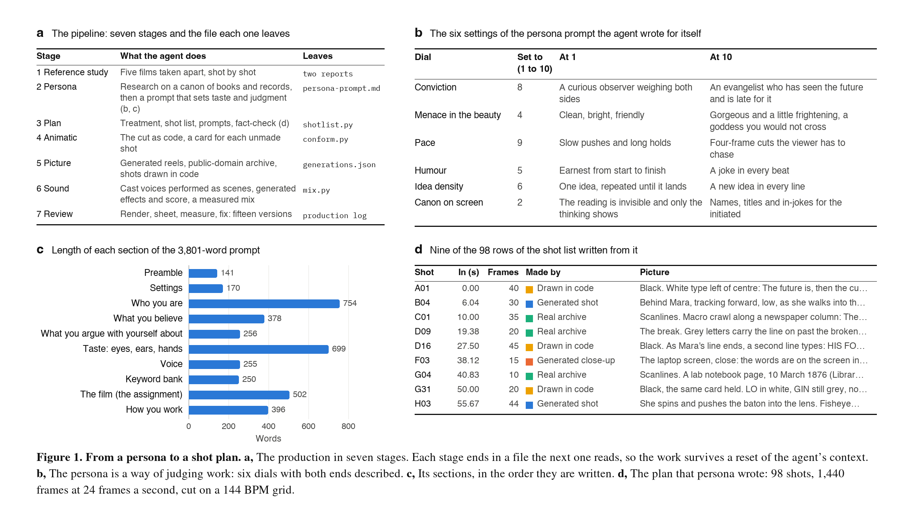

# The persona

A system prompt that gives the agent a film-maker's taste and judgment for the length of the production. It is
not a character to perform. Its preamble says so: "This is a way of judging work, so you do not need to act the
character in conversation."

| File | What it is |
| --- | --- |
| [persona-prompt.md](persona-prompt.md) | The prompt, about 3,800 words. Written to be used whole as a system prompt. |
| [persona-notes.md](persona-notes.md) | How to tune it: which section to change for which effect, and three behaviours to know about. |

## How it was made

1. **A brief.** The director described the film's imagined maker: someone formed by *Ender's Game*, Asimov and
   *The Beginning of Infinity*, a techno-optimist who listens to Grimes. The prompt was to be detailed, grounded
   in research, and adjustable.

2. **Research and a draft, in parallel.** The agent started one research run on that canon (the books, the
   techno-optimist essays, the music) and wrote a first full draft from its own knowledge while the run worked.
   When the report came back it checked the draft against it and revised the prompt seven times.

3. **What the research covered, stated plainly.** It confirmed the Asimov, techno-optimist and Grimes material and
   added to it. It found one page of book notes for Deutsch and no citable source for *Ender's Game*, so those
   sections rest on the model's own knowledge of the books and paraphrase them. The dates in the prompt's list of
   real events were not checked in that run. Every claim the film itself makes was checked later against a
   source that was opened and read, before anything went on screen (the fact-check is in
   [the plan](../docs/plan/treatment.md), under "True").

4. **Adoption.** The director returned the prompt as the role the agent was to work in, with one further
   instruction: plan every cut, scene, animation and transition before generating anything. The plan came next.

## Design choices

- **Six dials, 1 to 10, with both ends described**, so the output can be moved without rewriting prose:
  conviction, menace in the beauty, pace, humour, idea density, and how visible the canon is on screen.
- **Each belief is paired with what it does to the film.** "Problems are soluble" becomes "nothing is shown
  finished". The second half of each line is what moves the output.
- **A section of doubts**, "What you argue with yourself about", which keeps the work from reading as an
  advertisement for the future.
- **Intensity lives in the vocabulary, the beliefs and the pace targets.** The instructions themselves are
  written calmly; capital letters and "must" make a model rigid, not energetic.
- **A keyword bank larger than one film needs**, with an instruction to use a few per piece, because models
  over-use any word they are given.
- **The assignment is one section**, "The film", so the persona carries over to another brief.

Panels b and c of Figure 1 show the six dials as set for this film and the length of each section of the prompt.

## What is not here

The notes name two research files, `research-report.md` and `techno-optimist-creator-canon.json`. They were saved
in the production's first working folder and were not carried into the project, so they are not in this
repository. What the research did and did not establish is in step 3 above.
